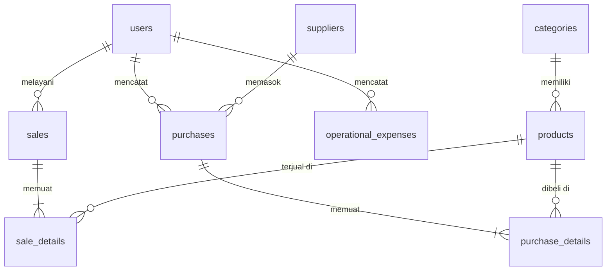

# Rancangan Final Projek: Aplikasi Pengelola Pemasukan & Pengeluaran Toko Swalayan

**Mata Kuliah:** Workshop Pemrograman Framework -- Semester 3 PENS
**Identitas Mahasiswa:**

| Field | Isi |
| :--- | :--- |
| **Nama 1** | *(isi nama lengkap)* |
| **NRP 1** | *(isi NRP)* |
| **Nama 2** | *(isi nama lengkap)* |
| **NRP 2** | *(isi NRP)* |
| **Kelas** | D3 Teknik Informatika *(isi kelas)* |

---

## 1. Gambaran Umum

Aplikasi ini adalah sistem berbasis web untuk mengelola arus kas (**pemasukan** dan **pengeluaran**) sekaligus mengontrol **stok barang** pada toko swalayan. Seluruh transaksi keuangan terhubung langsung dengan operasional toko, sehingga pencatatan kas tidak berdiri sendiri melainkan mencerminkan pergerakan barang secara *real-time*.

Arsitektur aplikasi menggunakan pola **SPA (Single Page Application)** dengan pemisahan penuh antara **frontend (React)** dan **backend (Laravel REST API)**, berkomunikasi seluruhnya melalui JSON API.

### Kesesuaian dengan Ketentuan Projek
* [x] **Aplikasi Baru (+5 Poin):** Membangun sistem baru dari nol (bukan kelanjutan aplikasi perpustakaan).
* [x] **Minimal 5 Tabel:** Menggunakan **9 tabel** yang saling berelasi (4 tabel master & 5 tabel transaksi).
* [x] **Transaksi Nyata:** Menggunakan pola *Header-Detail* untuk penjualan dan pembelian stok, disertai pembaruan stok otomatis, validasi stok, perhitungan subtotal/kembalian, serta rekap arus kas.
* [x] **Target Demo:** Siap didemokan pada **Minggu 12-15**.

---

## 2. Tech Stack

### Backend (Laravel API)

| Komponen | Teknologi |
| :--- | :--- |
| **Framework** | Laravel 12 |
| **PHP** | >= 8.2 |
| **Database** | MySQL / MariaDB (XAMPP) |
| **Autentikasi** | Laravel Sanctum (SPA token-based) |
| **Package Manager** | Composer |

### Frontend (React SPA)

| Komponen | Teknologi |
| :--- | :--- |
| **Library** | React 18+ |
| **Build Tool** | Vite |
| **Routing** | React Router v6 |
| **HTTP Client** | Axios |
| **Styling** | CSS / Bootstrap 5 / Tailwind (pilih salah satu) |
| **Package Manager** | npm |

### Struktur Folder Project

```
TasaZain/
|-- backend/          # Laravel 12 (REST API)
+-- frontend/         # React SPA (Vite)
```

---

## 3. Hak Akses Pengguna (Role)

| Role | Hak Akses & Fitur |
| :--- | :--- |
| **Admin / Pemilik** | Akses penuh: Dashboard Keuangan, Master Data (Kategori, Produk, Supplier, User), Transaksi Kulakan (Restock), Pencatatan Pengeluaran Operasional, Riwayat Penjualan, dan Laporan Laba Rugi. |
| **Kasir** | Akses terbatas: Dashboard Kasir, Transaksi Penjualan (POS), dan Riwayat Penjualan pribadi. |

---

## 4. Rancangan Database (9 Tabel)

### A. Tabel Master
1. **`users`** -- Menyimpan data akun pengelola dan kasir.
   * `id` (PK), `name`, `email` (Unique), `password`, `role` (`admin` / `kasir`), `created_at`, `updated_at`
2. **`categories`** -- Pengelompokan produk (Makanan, Minuman, Sembako, Kebersihan, dll.).
   * `id` (PK), `name`, `created_at`, `updated_at`
3. **`products`** -- Data barang dagangan beserta harga modal, harga jual, dan stok terkini.
   * `id` (PK), `category_id` (FK -> `categories.id`), `sku` (Unique), `name`, `buy_price`, `sell_price`, `stock`, `min_stock`, `created_at`, `updated_at`
4. **`suppliers`** -- Data pemasok barang untuk kulakan.
   * `id` (PK), `name`, `phone`, `address`, `created_at`, `updated_at`

### B. Tabel Transaksi
5. **`sales`** *(Header Penjualan / Pemasukan)* -- Menyimpan ringkasan nota penjualan kasir.
   * `id` (PK), `user_id` (FK -> `users.id`), `invoice_number` (Unique), `sale_date`, `total_amount`, `paid_amount`, `change_amount`, `created_at`, `updated_at`
6. **`sale_details`** *(Detail Penjualan)* -- Menyimpan rincian produk dalam satu nota penjualan.
   * `id` (PK), `sale_id` (FK -> `sales.id`), `product_id` (FK -> `products.id`), `qty`, `price`, `subtotal`
7. **`purchases`** *(Header Kulakan / Pengeluaran Stok)* -- Menyimpan ringkasan transaksi pembelian stok dari supplier.
   * `id` (PK), `supplier_id` (FK -> `suppliers.id`), `user_id` (FK -> `users.id`), `purchase_date`, `total_cost`, `note`, `created_at`, `updated_at`
8. **`purchase_details`** *(Detail Kulakan)* -- Menyimpan rincian produk yang dibeli dari supplier.
   * `id` (PK), `purchase_id` (FK -> `purchases.id`), `product_id` (FK -> `products.id`), `qty`, `buy_price`, `subtotal`
9. **`operational_expenses`** *(Pengeluaran Operasional)* -- Menyimpan biaya di luar pembelian barang (listrik, air, gaji, plastik, sewa tempat).
   * `id` (PK), `user_id` (FK -> `users.id`), `title`, `expense_date`, `amount`, `note`, `created_at`, `updated_at`

---

### C. Diagram Relasi (ERD)



---

## 5. Alur Logika Transaksi (Core Business Logic)

Untuk menjaga konsistensi data, seluruh proses penyimpanan transaksi (Header + Detail + Update Stok) **wajib dibungkus dengan Database Transaction** (contoh di Laravel: `DB::transaction()`).

### 1. Transaksi Penjualan (Pemasukan)
* Kasir memilih produk dan memasukkan jumlah (`qty`) ke keranjang belanja di React.
* Frontend memvalidasi `qty` tidak melebihi stok yang ditampilkan (client-side).
* Backend memvalidasi ulang stok (server-side) untuk mencegah race condition.
* Sistem menghitung `subtotal` per item, `total_amount`, dan `change_amount` (kembalian).
* Saat disimpan (POST ke `/api/sales`):
  1. Data masuk ke `sales` dan `sale_details`.
  2. `products.stock` **berkurang otomatis** sesuai `qty`.
  3. Nilai `total_amount` tercatat sebagai **Pemasukan**.

### 2. Transaksi Kulakan / Restock (Pengeluaran Stok)
* Admin memilih `supplier`, lalu memasukkan daftar produk, jumlah (`qty`), dan harga beli (`buy_price`).
* Saat disimpan (POST ke `/api/purchases`):
  1. Data masuk ke `purchases` dan `purchase_details`.
  2. `products.stock` **bertambah otomatis** sesuai `qty` (dan harga beli terbaru dapat diperbarui).
  3. Nilai `total_cost` tercatat sebagai **Pengeluaran**.

### 3. Transaksi Pengeluaran Operasional
* Admin menginput nama pengeluaran (misal: *Tagihan Listrik Bulan Ini*), tanggal, nominal, dan catatan.
* Nilai `amount` langsung masuk ke rekap **Pengeluaran**.

### 4. Rumus Ringkasan Keuangan (Dashboard & Laporan)
Pada periode tertentu (harian, bulanan, atau rentang tanggal):

**Total Pemasukan** = SUM(sales.total_amount)

**Total Pengeluaran** = SUM(purchases.total_cost) + SUM(operational_expenses.amount)

**Laba Bersih (Arus Kas)** = Total Pemasukan - Total Pengeluaran

---

## 6. Daftar Fitur Utama

1. **Autentikasi & Multi-Role:** Login/Logout via Sanctum SPA authentication, protected routes di React berdasarkan role.
2. **Dashboard Ringkas:**
   * Kartu ringkasan: Pemasukan, Pengeluaran, dan Laba Bersih (bulan ini).
   * Peringatan daftar produk dengan stok menipis (`stock <= min_stock`).
   * Grafik sederhana perbandingan pemasukan vs pengeluaran.
   * Semua data di-fetch dari endpoint `/api/stats`.
3. **Manajemen Master Data:** CRUD Kategori, Produk, Supplier, dan Pengguna.
4. **Kasir (POS Penjualan):** Keranjang belanja dinamis (React state), hitung kembalian otomatis, dan cetak struk.
5. **Manajemen Kulakan & Pengeluaran:** Form input pembelian stok multi-item dan form pengeluaran operasional.
6. **Laporan Arus Kas:** Filter berdasarkan rentang tanggal + tombol cetak/export PDF.

---

## 7. Arsitektur Backend (Laravel REST API)

### A. Models (`app/Models/`)

| Model | Tabel | Relasi Eloquent |
| :--- | :--- | :--- |
| `User` | `users` | `hasMany(Sale)`, `hasMany(Purchase)`, `hasMany(OperationalExpense)` |
| `Category` | `categories` | `hasMany(Product)` |
| `Product` | `products` | `belongsTo(Category)`, `hasMany(SaleDetail)`, `hasMany(PurchaseDetail)` |
| `Supplier` | `suppliers` | `hasMany(Purchase)` |
| `Sale` | `sales` | `belongsTo(User)`, `hasMany(SaleDetail)` |
| `SaleDetail` | `sale_details` | `belongsTo(Sale)`, `belongsTo(Product)` |
| `Purchase` | `purchases` | `belongsTo(Supplier)`, `belongsTo(User)`, `hasMany(PurchaseDetail)` |
| `PurchaseDetail` | `purchase_details` | `belongsTo(Purchase)`, `belongsTo(Product)` |
| `OperationalExpense` | `operational_expenses` | `belongsTo(User)` |

### B. API Controllers (`app/Http/Controllers/Api/`)

| Controller | Tanggung Jawab |
| :--- | :--- |
| `AuthController` | Login (`POST /api/login`), Logout (`POST /api/logout`), Get user (`GET /api/user`) via Sanctum |
| `StatsController` | `GET /api/stats` -- Statistik dashboard |
| `CategoryController` | CRUD `/api/categories` (khusus Admin) |
| `ProductController` | CRUD `/api/products` |
| `SupplierController` | CRUD `/api/suppliers` (khusus Admin) |
| `SaleController` | Transaksi penjualan: `GET /api/sales`, `POST /api/sales`, `GET /api/sales/{id}` |
| `PurchaseController` | Transaksi kulakan: `GET /api/purchases`, `POST /api/purchases`, `GET /api/purchases/{id}` |
| `OperationalExpenseController` | CRUD `/api/expenses` |
| `ReportController` | `GET /api/report` -- Laporan arus kas dengan filter tanggal |

### C. Middleware

| Middleware | Fungsi |
| :--- | :--- |
| `auth:sanctum` | Memastikan request terautentikasi via Sanctum token |
| `CheckAdminRole` | Memastikan hanya user dengan `role = admin` yang bisa akses route tertentu |

### D. Form Requests (`app/Http/Requests/`)

| Form Request | Validasi Untuk |
| :--- | :--- |
| `LoginRequest` | Validasi login (email, password) |
| `StoreCategoryRequest` | Validasi input kategori (name required, unique) |
| `StoreProductRequest` | Validasi input produk (name, sku unique, buy_price, sell_price, category_id, min_stock) |
| `StoreSupplierRequest` | Validasi input supplier (name, phone) |
| `StoreSaleRequest` | Validasi transaksi penjualan (items array, qty, paid_amount) |
| `StorePurchaseRequest` | Validasi transaksi kulakan (supplier_id, items array, qty, buy_price) |
| `StoreExpenseRequest` | Validasi pengeluaran operasional (title, amount, expense_date) |

### E. API Resources (`app/Http/Resources/`)

| Resource | Transform Data |
| :--- | :--- |
| `UserResource` | User data (tanpa password) |
| `ProductResource` | Product + relasi category |
| `SaleResource` | Sale + relasi user + saleDetails.product |
| `PurchaseResource` | Purchase + relasi supplier + user + purchaseDetails.product |
| `CategoryResource` | Category data |
| `SupplierResource` | Supplier data |
| `ExpenseResource` | Operational expense data |

### F. Routes (`routes/api.php`)

```php
use App\Http\Controllers\Api\AuthController;
use App\Http\Controllers\Api\CategoryController;
use App\Http\Controllers\Api\ProductController;
use App\Http\Controllers\Api\SupplierController;
use App\Http\Controllers\Api\SaleController;
use App\Http\Controllers\Api\PurchaseController;
use App\Http\Controllers\Api\OperationalExpenseController;
use App\Http\Controllers\Api\StatsController;
use App\Http\Controllers\Api\ReportController;

// Public (tanpa auth)
Route::post('/login', [AuthController::class, 'login']);

// Protected (semua role)
Route::middleware('auth:sanctum')->group(function () {
    Route::post('/logout', [AuthController::class, 'logout']);
    Route::get('/user', [AuthController::class, 'user']);

    Route::get('/stats', [StatsController::class, 'index']);
    Route::get('/report', [ReportController::class, 'index']);

    Route::apiResource('products', ProductController::class);
    Route::apiResource('sales', SaleController::class)->only(['index', 'store', 'show']);

    // Khusus Admin
    Route::middleware('admin')->group(function () {
        Route::apiResource('categories', CategoryController::class);
        Route::apiResource('suppliers', SupplierController::class);
        Route::apiResource('purchases', PurchaseController::class)->only(['index', 'store', 'show']);
        Route::apiResource('expenses', OperationalExpenseController::class);
    });
});
```

### G. Migrations (`database/migrations/`)

Urutan migration (penting karena foreign key):
1. `create_users_table` *(bawaan Laravel)*
2. `create_cache_table` *(bawaan Laravel)*
3. `create_jobs_table` *(bawaan Laravel)*
4. `create_personal_access_tokens_table` *(bawaan Sanctum)*
5. `create_categories_table`
6. `create_suppliers_table`
7. `create_products_table` -- FK ke `categories`
8. `create_sales_table` -- FK ke `users`
9. `create_sale_details_table` -- FK ke `sales`, `products`
10. `create_purchases_table` -- FK ke `suppliers`, `users`
11. `create_purchase_details_table` -- FK ke `purchases`, `products`
12. `create_operational_expenses_table` -- FK ke `users`

### H. Seeders & Factories (`database/seeders/` & `database/factories/`)

| File | Isi Data Dummy |
| :--- | :--- |
| `UserSeeder` | 2 akun: Admin + Kasir (password: `password`) |
| `CategorySeeder` | 5-8 kategori baku (Makanan Ringan, Minuman, Sembako, Kebersihan, ATK, dll.) |
| `SupplierSeeder` | 3-5 supplier fiktif (toko grosir, distributor) |
| `ProductFactory` + `ProductSeeder` | 30-50 produk dengan SKU, harga modal, harga jual, stok awal |
| `SaleSeeder` | 10 transaksi penjualan awal dengan detail item |
| `PurchaseSeeder` | 5 transaksi kulakan awal dengan detail item |
| `OperationalExpenseSeeder` | 5 pengeluaran operasional (listrik, air, gaji, dll.) |
| `DatabaseSeeder` | Memanggil semua seeder di atas secara berurutan |

> **Catatan:** Gunakan locale `id_ID` di Faker agar data dummy terasa Indonesia.

---

## 8. Arsitektur Frontend (React SPA)

### A. Struktur Folder

```
frontend/
|-- public/
|   +-- vite.svg
|-- src/
|   |-- api/
|   |   +-- axios.js              # Axios instance (baseURL, interceptor, Sanctum CSRF)
|   |-- components/
|   |   |-- Layout.jsx             # Layout utama (Sidebar + Navbar + Outlet)
|   |   |-- Navbar.jsx             # Navbar (nama user, role, logout)
|   |   |-- Sidebar.jsx            # Sidebar navigasi (role-aware)
|   |   |-- ProtectedRoute.jsx     # Route guard (cek auth + role)
|   |   |-- StatCard.jsx           # Komponen kartu statistik dashboard
|   |   |-- ProductTable.jsx       # Tabel produk reusable
|   |   |-- CartItem.jsx           # Item di keranjang POS
|   |   +-- ...
|   |-- pages/
|   |   |-- Login.jsx
|   |   |-- Dashboard.jsx
|   |   |-- categories/
|   |   |   |-- CategoryList.jsx
|   |   |   +-- CategoryForm.jsx
|   |   |-- products/
|   |   |   |-- ProductList.jsx
|   |   |   +-- ProductForm.jsx
|   |   |-- suppliers/
|   |   |   |-- SupplierList.jsx
|   |   |   +-- SupplierForm.jsx
|   |   |-- sales/
|   |   |   |-- SaleList.jsx       # Riwayat penjualan
|   |   |   |-- SaleCreate.jsx     # Form POS (keranjang belanja dinamis)
|   |   |   +-- SaleDetail.jsx     # Detail nota / cetak struk
|   |   |-- purchases/
|   |   |   |-- PurchaseList.jsx
|   |   |   |-- PurchaseCreate.jsx # Form kulakan multi-item
|   |   |   +-- PurchaseDetail.jsx
|   |   |-- expenses/
|   |   |   |-- ExpenseList.jsx
|   |   |   +-- ExpenseForm.jsx
|   |   +-- report/
|   |       +-- Report.jsx         # Laporan arus kas + filter tanggal
|   |-- context/
|   |   +-- AuthContext.jsx        # React Context untuk state autentikasi (user, token, role)
|   |-- hooks/
|   |   +-- useAuth.js             # Custom hook untuk akses AuthContext
|   |-- App.jsx                    # Root component + React Router setup
|   |-- main.jsx                   # Entry point
|   +-- index.css                  # Global styles
|-- index.html
|-- vite.config.js
+-- package.json
```

### B. Routing (React Router)

```jsx
// App.jsx
<BrowserRouter>
  <Routes>
    {/* Public */}
    <Route path="/login" element={<Login />} />

    {/* Protected - Semua Role */}
    <Route element={<ProtectedRoute />}>
      <Route element={<Layout />}>
        <Route path="/" element={<Dashboard />} />
        <Route path="/products" element={<ProductList />} />
        <Route path="/products/create" element={<ProductForm />} />
        <Route path="/products/:id/edit" element={<ProductForm />} />
        <Route path="/sales" element={<SaleList />} />
        <Route path="/sales/create" element={<SaleCreate />} />
        <Route path="/sales/:id" element={<SaleDetail />} />

        {/* Protected - Khusus Admin */}
        <Route element={<ProtectedRoute requiredRole="admin" />}>
          <Route path="/categories" element={<CategoryList />} />
          <Route path="/categories/create" element={<CategoryForm />} />
          <Route path="/categories/:id/edit" element={<CategoryForm />} />
          <Route path="/suppliers" element={<SupplierList />} />
          <Route path="/suppliers/create" element={<SupplierForm />} />
          <Route path="/suppliers/:id/edit" element={<SupplierForm />} />
          <Route path="/purchases" element={<PurchaseList />} />
          <Route path="/purchases/create" element={<PurchaseCreate />} />
          <Route path="/purchases/:id" element={<PurchaseDetail />} />
          <Route path="/expenses" element={<ExpenseList />} />
          <Route path="/expenses/create" element={<ExpenseForm />} />
          <Route path="/expenses/:id/edit" element={<ExpenseForm />} />
          <Route path="/report" element={<Report />} />
        </Route>
      </Route>
    </Route>
  </Routes>
</BrowserRouter>
```

### C. Axios Instance & Sanctum

```js
// src/api/axios.js
import axios from 'axios';

const api = axios.create({
    baseURL: 'http://127.0.0.1:8000/api',
    withCredentials: true,          // Penting untuk Sanctum SPA cookie
    headers: {
        'Accept': 'application/json',
        'Content-Type': 'application/json',
    },
});

// Interceptor: redirect ke login jika 401
api.interceptors.response.use(
    response => response,
    error => {
        if (error.response?.status === 401) {
            window.location.href = '/login';
        }
        return Promise.reject(error);
    }
);

export default api;
```

### D. Auth Flow (Sanctum SPA)

```
1. React mengirim GET ke /sanctum/csrf-cookie (mendapat XSRF-TOKEN cookie)
2. React mengirim POST /api/login { email, password }
3. Laravel memvalidasi, membuat session, mengembalikan user data + role
4. React menyimpan user di AuthContext
5. Setiap request berikutnya otomatis menyertakan cookie session
6. ProtectedRoute mengecek AuthContext sebelum render halaman
```

---

## 9. Konfigurasi Environment

### Backend (`backend/.env`)

```env
APP_NAME="Swalayan POS API"
APP_URL=http://127.0.0.1:8000

DB_CONNECTION=mysql
DB_HOST=127.0.0.1
DB_PORT=3306
DB_DATABASE=db_swalayan
DB_USERNAME=root
DB_PASSWORD=

# Sanctum: izinkan frontend React mengakses API
SANCTUM_STATEFUL_DOMAINS=localhost:5173,127.0.0.1:5173
SESSION_DOMAIN=localhost

# CORS: izinkan origin frontend
CORS_ALLOWED_ORIGINS=http://localhost:5173,http://127.0.0.1:5173

APP_FAKER_LOCALE=id_ID
```

### Frontend (`frontend/.env`)

```env
VITE_API_BASE_URL=http://127.0.0.1:8000/api
```

---

## 10. Akun Demo (Seeder)

| Role | Nama | Email | Password |
| :--- | :--- | :--- | :--- |
| **Admin** | *(isi nama)* | `admin@swalayan.test` | `password` |
| **Kasir** | *(isi nama)* | `kasir@swalayan.test` | `password` |

---

## 11. Dokumentasi REST API

Semua endpoint mengembalikan JSON. Auth menggunakan Sanctum SPA cookie-based.

### Auth

| Method | Endpoint | Auth | Keterangan |
| :--- | :--- | :--- | :--- |
| `GET` | `/sanctum/csrf-cookie` | - | Mendapatkan CSRF token (wajib sebelum login) |
| `POST` | `/api/login` | - | Login, body: `{ email, password }` |
| `POST` | `/api/logout` | Sanctum | Logout, hapus session |
| `GET` | `/api/user` | Sanctum | Mendapatkan data user yang sedang login + role |

### Dashboard & Laporan

| Method | Endpoint | Auth | Keterangan |
| :--- | :--- | :--- | :--- |
| `GET` | `/api/stats` | Sanctum | Statistik dashboard (pemasukan, pengeluaran, laba, stok menipis) |
| `GET` | `/api/report` | Admin | Laporan arus kas (query: `?start_date=...&end_date=...`) |

### Master Data

| Method | Endpoint | Auth | Keterangan |
| :--- | :--- | :--- | :--- |
| `GET` | `/api/categories` | Admin | Daftar kategori |
| `POST` | `/api/categories` | Admin | Tambah kategori |
| `PUT` | `/api/categories/{id}` | Admin | Update kategori |
| `DELETE` | `/api/categories/{id}` | Admin | Hapus kategori |
| `GET` | `/api/products` | Sanctum | Daftar produk (paginated, dengan relasi kategori) |
| `GET` | `/api/products/{id}` | Sanctum | Detail produk |
| `POST` | `/api/products` | Admin | Tambah produk |
| `PUT` | `/api/products/{id}` | Admin | Update produk |
| `DELETE` | `/api/products/{id}` | Admin | Hapus produk |
| `GET` | `/api/suppliers` | Admin | Daftar supplier |
| `POST` | `/api/suppliers` | Admin | Tambah supplier |
| `PUT` | `/api/suppliers/{id}` | Admin | Update supplier |
| `DELETE` | `/api/suppliers/{id}` | Admin | Hapus supplier |

### Transaksi

| Method | Endpoint | Auth | Keterangan |
| :--- | :--- | :--- | :--- |
| `GET` | `/api/sales` | Sanctum | Daftar penjualan (paginated) |
| `POST` | `/api/sales` | Sanctum | Buat transaksi penjualan baru (Header + Detail) |
| `GET` | `/api/sales/{id}` | Sanctum | Detail nota penjualan |
| `GET` | `/api/purchases` | Admin | Daftar kulakan (paginated) |
| `POST` | `/api/purchases` | Admin | Buat transaksi kulakan baru (Header + Detail) |
| `GET` | `/api/purchases/{id}` | Admin | Detail nota kulakan |
| `GET` | `/api/expenses` | Admin | Daftar pengeluaran operasional |
| `POST` | `/api/expenses` | Admin | Tambah pengeluaran |
| `PUT` | `/api/expenses/{id}` | Admin | Update pengeluaran |
| `DELETE` | `/api/expenses/{id}` | Admin | Hapus pengeluaran |

---

## 12. Cara Menjalankan Project

### Prasyarat
- PHP >= 8.2 + Composer
- Node.js >= 18 + npm
- MySQL / MariaDB (e.g. XAMPP)
- Git

### Langkah Instalasi

**1. Setup Backend (Laravel API)**
```bash
# Inisialisasi project Laravel baru
composer create-project laravel/laravel backend
cd backend

# Install Sanctum
php artisan install:api

# Konfigurasi .env (database, Sanctum, CORS)
# Lalu jalankan:
php artisan migrate:fresh --seed
php artisan serve --port=8000
```

**2. Setup Frontend (React SPA)**
```bash
# Dari root folder TasaZain
npm create vite@latest frontend -- --template react
cd frontend
npm install

# Install dependencies tambahan
npm install axios react-router-dom

# Konfigurasi .env (VITE_API_BASE_URL)
npm run dev
# Frontend berjalan di http://localhost:5173
```

**3. Jalankan Keduanya**
- **Terminal 1:** `cd backend && php artisan serve --port=8000` (Laravel API)
- **Terminal 2:** `cd frontend && npm run dev` (React dev server, port 5173)
- Buka `http://localhost:5173` di browser

---

## 13. Skenario Demo Live (Panduan UAS)

### Pre-Demo Checklist
```bash
# Terminal 1 - Backend
cd backend
php artisan migrate:fresh --seed
php artisan serve --port=8000

# Terminal 2 - Frontend
cd frontend
npm run dev
```

Buka browser di `http://localhost:5173`

### Urutan Langkah Demo

#### 1. Login sebagai Admin
- Halaman: `/login`
- Masukkan email Admin + password `password`
- Tunjukkan: redirect ke Dashboard, navbar menampilkan nama + role
- **Jelaskan:** Auth menggunakan Sanctum SPA (cookie-based), React menyimpan state user di Context

#### 2. Dashboard Statistik (Pertemuan 10)
- Tunjukkan kartu: Total Pemasukan, Total Pengeluaran, Laba Bersih, Produk Stok Menipis
- **Jelaskan:** React fetch data dari `GET /api/stats` via Axios, data dirender sebagai komponen React

#### 3. CRUD Kategori (Pertemuan 2, 3, 5, 8)
- Tambah kategori baru -> tunjukkan validasi (server-side error ditampilkan di React) & notifikasi sukses

#### 4. CRUD Produk & Relasi Kategori (Pertemuan 3, 5, 7)
- Tambah produk baru dengan dropdown kategori (data dari API)
- Tunjukkan: Eager Loading di backend, Pagination di React

#### 5. CRUD Supplier
- Tambah data supplier baru

#### 6. Transaksi Penjualan / POS (Pertemuan 7)
- Login sebagai Kasir
- Buat transaksi penjualan multi-item menggunakan **keranjang belanja React** (dynamic state management)
- Tunjukkan: validasi stok (client + server), perhitungan subtotal & kembalian otomatis (React computed)
- Tunjukkan: stok produk berkurang otomatis setelah transaksi berhasil

#### 7. Transaksi Kulakan / Restock
- Login kembali sebagai Admin
- Buat transaksi pembelian stok dari supplier (form multi-item React)
- Tunjukkan: stok produk bertambah otomatis

#### 8. Pencatatan Pengeluaran Operasional
- Input pengeluaran (listrik, gaji, dll.)

#### 9. Laporan Arus Kas
- Tunjukkan halaman laporan dengan date range picker
- Filter data berdasarkan tanggal -> tabel dan ringkasan berubah dinamis tanpa reload (SPA behavior)

#### 10. Pengujian REST API di Postman (Pertemuan 9)
- `GET /api/stats` -> Status `200 OK`, JSON statistik
- `GET /api/products` -> Status `200 OK`, paginated + relasi kategori (API Resource)
- `GET /api/sales` -> Status `200 OK`, data penjualan
- `POST /api/products` dengan body `{}` -> Status `422`, validasi error JSON terstandar

#### 11. Tanya Jawab Konseptual (Pertemuan 11)
Siap menjawab pertanyaan seputar:
- Arsitektur SPA (React) + REST API (Laravel) vs MVC monolith
- Laravel Sanctum SPA Authentication (CSRF + Session Cookie)
- Eloquent ORM: Relasi, Eager Loading, N+1 Query Problem
- Database Transaction (`DB::transaction()`) untuk integritas data
- React: Component lifecycle, State management (Context), Client-side routing
- API Resource & JSON Response standardization
- CORS configuration untuk komunikasi cross-origin

---

## 14. Roadmap Pengerjaan (Menuju Demo Minggu 12-15)

| Tahap | Fokus | Deliverables |
| :--- | :--- | :--- |
| **1 -- Setup Project** | Inisialisasi Laravel 12 (`backend/`), React Vite (`frontend/`), konfigurasi `.env`, Sanctum, CORS | Dua project tersetup, bisa saling berkomunikasi |
| **2 -- Database & Auth** | Semua migration (9 tabel), model + relasi Eloquent, seeder/factory, `AuthController` + Sanctum login/logout, React `AuthContext` + `Login.jsx` + `ProtectedRoute.jsx` | Database siap, auth berfungsi end-to-end |
| **3 -- Master Data CRUD** | API: `CategoryController`, `ProductController`, `SupplierController` + Form Requests + Resources. React: halaman list + form untuk Kategori, Produk, Supplier | CRUD master data berfungsi full-stack |
| **4 -- Transaksi Inti** | API: `SaleController`, `PurchaseController`, `ExpenseController` dengan `DB::transaction()`. React: form POS (keranjang dinamis), form kulakan multi-item, form pengeluaran | Transaksi berjalan dengan update stok otomatis |
| **5 -- Dashboard & Laporan** | API: `StatsController`, `ReportController`. React: `Dashboard.jsx` (stat cards + grafik), `Report.jsx` (filter tanggal + tabel) | Dashboard dan laporan berfungsi |
| **6 -- Polish & Demo** | Styling & responsiveness, cetak struk/PDF, error handling, loading states, uji coba alur lengkap, persiapan skenario demo | Final polish, testing, dokumentasi |